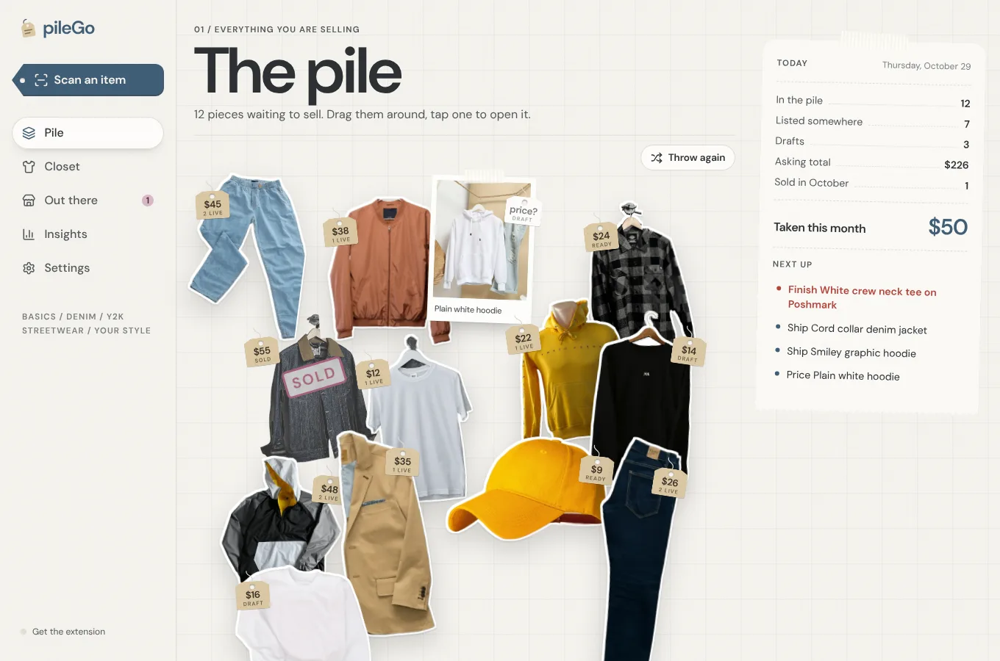
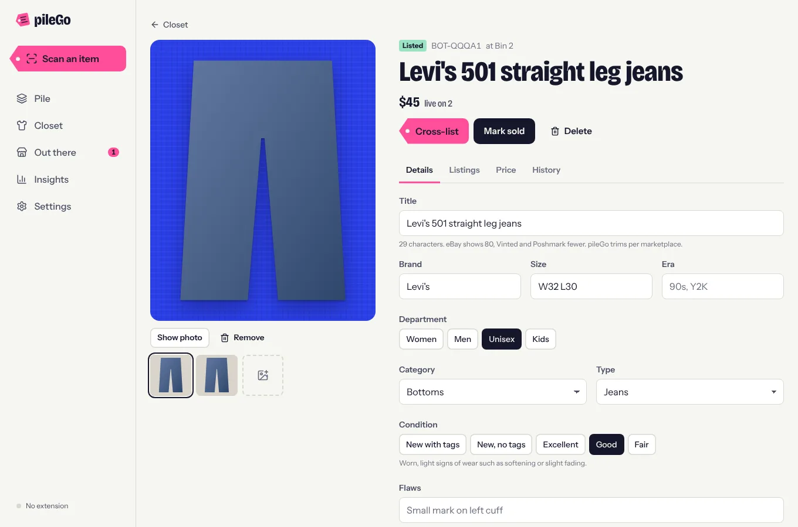
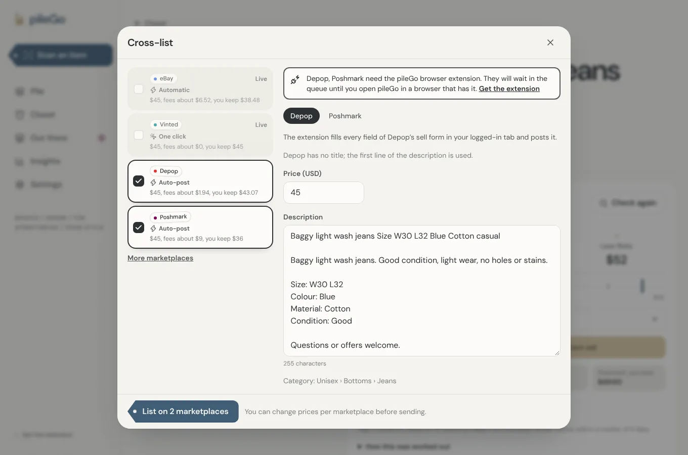
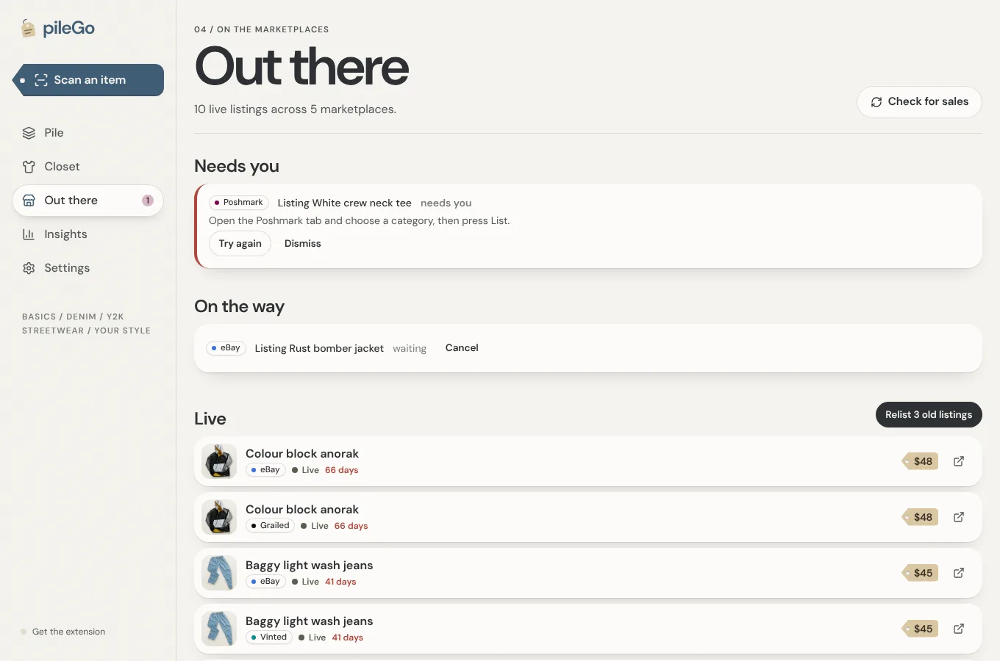
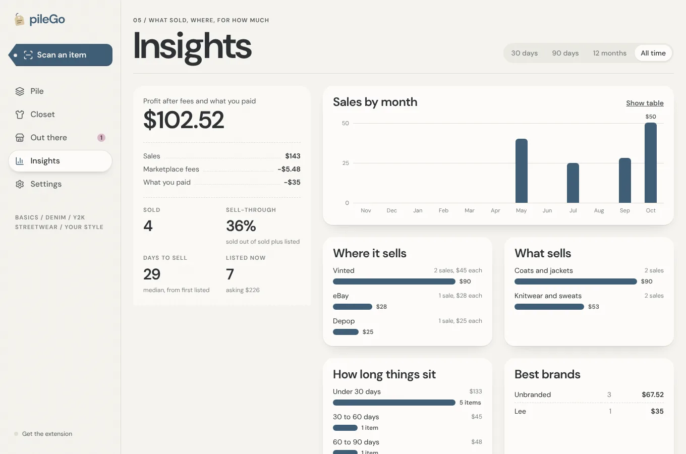
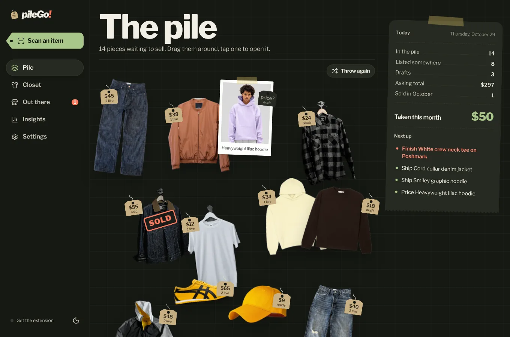
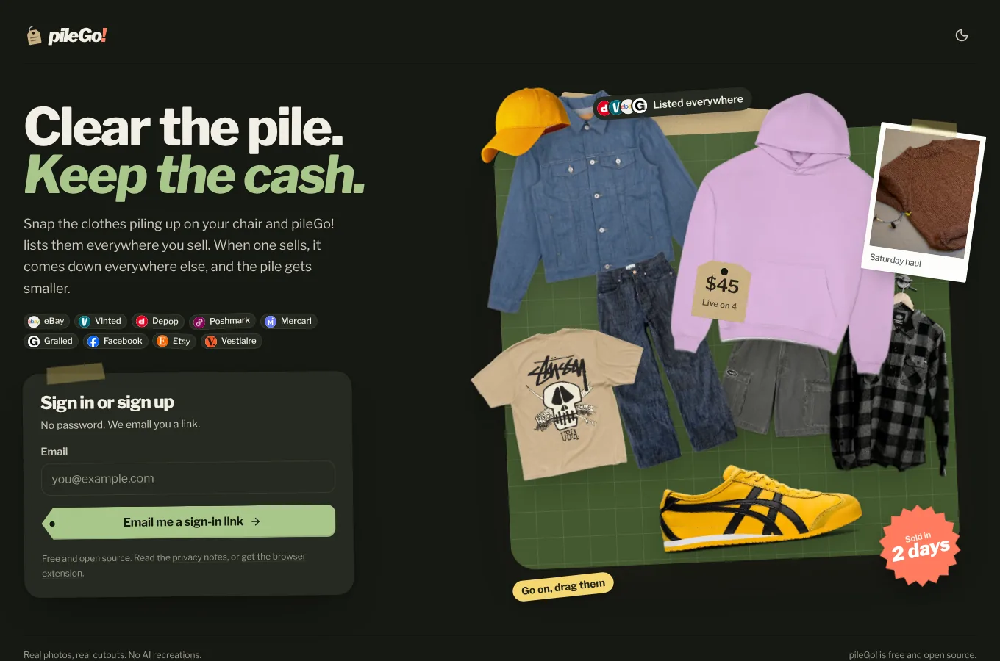

# pileGo!

A free, open-source closet for people who resell clothes. Photograph a piece,
let the AI fill in the listing, and send it to eBay, Vinted, Depop, Poshmark,
Mercari, Grailed and Facebook Marketplace from one place. When it sells
somewhere, pileGo! takes it down everywhere else.



## What it does

- **Scan.** Take or drop up to 12 photos. The AI reads the brand, size, colours,
  materials, condition and flaws, writes a description in your voice, and
  suggests a price. The background is cut out in your browser, for free.
- **One closet.** Every piece has one record: photos, measurements, what you
  paid, where it is stored, and where it is listed. Switch between a rack view
  and a table, filter, search, and act on many items at once.
- **Cross-list.** Pick marketplaces and pileGo writes each one's title,
  description, hashtags and price within that site's limits. You can edit each
  version before it goes. Prices can be the same everywhere, or set so you
  keep the same amount after each site's fees.
- **Relist.** Listings older than the age you choose get a reminder, and one
  button relists them on the sites that allow it.
- **Sales.** Sales come in from eBay's API, your Vinted wardrobe and the public
  listing pages of Depop, Poshmark, Mercari and Grailed. You can also record an
  in-person sale by hand. Each sale queues removal from every other
  marketplace.
- **Pricing.** Suggestions blend the AI's estimate, comparable eBay listings
  and your own past sales, and tell you why.
- **Insights.** Profit after fees and cost, sell-through, days to sell, sales
  by month, marketplace, category and brand, and what has been sitting too
  long.

| | |
|---|---|
|  |  |
|  |  |
|  |  |

## How pileGo reaches each marketplace

Only eBay offers sellers a public API. For the rest, pileGo is honest about
how much it can do, and the app labels every marketplace with one of these:

| Label | What happens |
|---|---|
| **Automatic** | The server uses the marketplace's official API. This works with your browser closed. |
| **One click** | The pileGo browser extension uses the marketplace's own web endpoints from your logged-in tab. You don't touch a form. |
| **Auto-post** | The extension opens the sell form in your logged-in tab, fills every field and presses the site's own post button. You can press Stop in the first few seconds. |
| **Assisted** | The extension opens the sell form, adds the photos and fills in what it can. You check it and press the site's own post button. |
| **Listing kit** | Copy-ready text, a photo download and a link to the sell page. |

| Marketplace | List | Take down | Relist | Sales | Import |
|---|---|---|---|---|---|
| eBay | Automatic | Automatic | Automatic | Automatic | Automatic |
| Vinted | One click | One click | One click | One click (wardrobe) | One click |
| Depop | Auto-post | Assisted | | Public listing page | |
| Poshmark | Auto-post | Assisted | | Public listing page | |
| Mercari | Assisted | Assisted | | Public listing page | |
| Grailed | Assisted | Assisted | | Public listing page | |
| Facebook Marketplace | Assisted | By hand | | By hand | |
| Etsy | Listing kit | By hand | | By hand | |
| Vestiaire Collective | Listing kit | By hand | | By hand | |

The Vinted engine keeps a human pace. It pauses between steps, caps how many
listings it creates per hour and per day, and stops for a while if Vinted rate
limits it or shows a bot check. Automating your own account on a marketplace
may still go against its terms; pileGo cannot make that risk zero. See
[docs/marketplaces.md](docs/marketplaces.md) for the details for each site.

## Run your own

pileGo is built to run on free tiers:

- **Supabase:** database, sign-in, photo storage and server functions.
- **Google Gemini:** the AI scan. Its free tier covers a seller's daily scanning.
- **Cloudflare Pages**, or any static host: the web app.

The full walkthrough is in [docs/self-hosting.md](docs/self-hosting.md). In short:

```sh
pnpm install
SUPABASE_ACCESS_TOKEN=… SUPABASE_PROJECT_REF=… GEMINI_API_KEY=… \
PILEGO_APP_URL=https://your-app.pages.dev node scripts/deploy.mjs
pnpm --filter @pilego/web build          # deploy apps/web/dist
# The web build also builds the extension and serves it at /downloads; see /extension in the app.
```

## Develop

```sh
pnpm install
cp apps/web/.env.example apps/web/.env.local   # point it at a Supabase project
pnpm dev                                       # web app on http://localhost:5173
pnpm --filter @pilego/extension dev            # extension in apps/extension/dist/chrome
```

| Command | What it checks |
|---|---|
| `pnpm typecheck` | Every package |
| `pnpm test` | Unit tests: core, web, extension |
| `pnpm test:e2e` | The web app in Chromium against a mocked backend, and the extension against mock marketplace pages |
| `bash supabase/tests/run-local.sh` | Migrations, row-level security and the sale logic, on a throwaway Postgres |
| `cd supabase/functions && deno check --config deno.json */index.ts` | Edge functions |

How the pieces fit together is in [docs/architecture.md](docs/architecture.md).

## Licence and credits

AGPL-3.0-or-later. If you run a modified pileGo for other people, share your
changes. The Vinted engine is adapted from [Bumpline](CREDITS.md#bumpline);
see [CREDITS.md](CREDITS.md).

